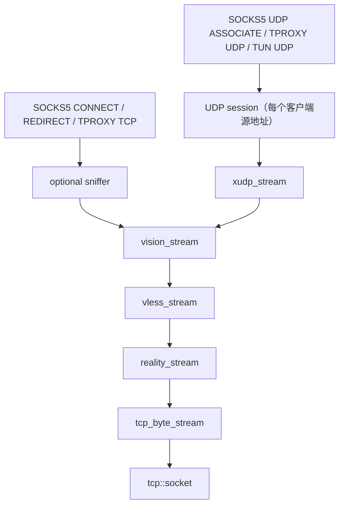
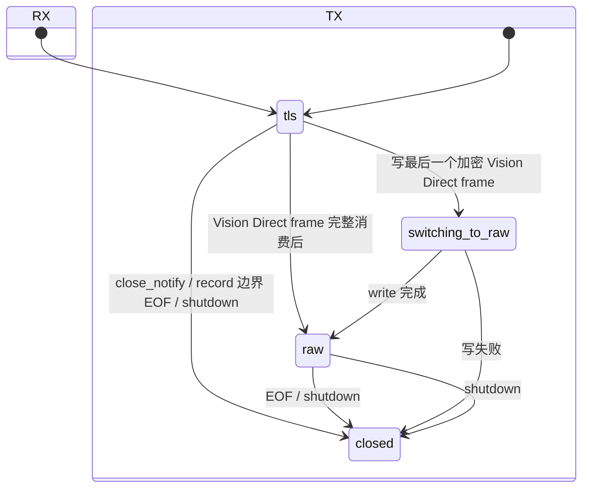

# 架构与协程契约

## 1. 所有权与调用方向

TCP 与 UDP 在 VLESS request 层分叉：TCP 使用 command `0x01`，UDP 使用 Xray XUDP（command `0x03` Mux），两者都经过 Vision：

TCP stream 没有后台 reader，也没有通用 packet dispatcher。上层调用 `read(output)` 时，下层才读取足够的数据来产生结果，
写入同理。UDP 入口按 datagram 驱动；每个 UDP 会话内部保持一个 XUDP uplink writer 和一个 downlink reader。

SOCKS5 服务负责监听、认证协商以及解析 `CONNECT` / `UDP ASSOCIATE`。认证未配置时选择无认证，配置凭据时选择 RFC 1929
用户名密码认证。TCP CONNECT 的 IP 目标可以由 `sniffer` 从首包 TLS SNI / HTTP Host 恢复域名；UDP ASSOCIATE 不 sniff，
每个 SOCKS5 UDP datagram 自带目标地址和端口。SOCKS5 协议模块本身不依赖 REALITY、VLESS、Vision 或 sniffer。

Linux IPv4 transparent 与 SOCKS5 并列。TCP REDIRECT accepted socket 通过 `SO_ORIGINAL_DST` 恢复 NAT 前目标；TCP TPROXY
listener 在 bind 前设置 `IP_TRANSPARENT`，accepted socket local endpoint 保留原目标。UDP TPROXY socket 同时启用
`IP_TRANSPARENT` 与 `IP_RECVORIGDSTADDR`，通过 `recvmsg()` 对每个 datagram 取得 client endpoint 和 original destination。
iptables/nftables、fwmark 与 policy routing 保持在程序外部。通用 UDP REDIRECT 不实现。

域名目标的连接建立顺序为：

1. `tcp_byte_stream::connect()` 解析地址并建立 TCP；
2. `reality_stream::connect()` 完成 REALITY/TLS 1.3 handshake；
3. `vless_stream::connect()` 编码 VLESS request header，暂存到首次写入；
4. `vision_stream::connect()` 发送带 UUID 的初始 padding frame，与 request header 合并为同一个 TLS record；
5. 返回 SOCKS success，再进入双向 relay。

IP 目标为了让客户端先产生 ClientHello/HTTP request，会在第 2 步后返回 SOCKS success，
最多缓存客户端首个 16 KiB / 200 ms。探测到域名后再执行第 3、4 步，并把缓存字节原样写入
`vision_stream`；探测失败、超时或达到上限时保持原 IP。透明入口没有 SOCKS handshake，因此 accept 后先恢复
original destination 并建立 REALITY，再执行同样的首包探测和第 3、4 步。TLS sniffer 只解析首个完整
ClientHello handshake record；跨 TLS record 的 ClientHello 直接按探测失败处理，不影响原始数据转发。
SOCKS5 入站协商及上游 TCP 建连与 REALITY 握手均限制为 60 秒。

## 2. 核心数据结构

| 类型 | 主要状态 | 职责 |
|---|---|---|
| `core::byte_queue` | bounded byte vector + begin offset | 保存跨 TLS record 的 handshake 或明文碎片，限制内存增长 |
| `crypto::aead` | 私有 PImpl | 封装 BoringSSL `EVP_AEAD_CTX`，不向其他模块暴露 BoringSSL 类型 |
| `reality::record_key` | AEAD、12-byte IV、sequence | TLS 1.3 单方向 record protection |
| `reality::reality_stream` | RX/TX mode、receive/send key、两个 byte_queue | TLS application records 与 raw TCP 之间切换 |
| `vless::vless_stream` | pending request header、response header pending flag | VLESS TCP request/response header 与 stream body |
| `xudp::xudp_stream` | GlobalID、首个目的地址 | 在 `vision_stream` 上编码 XUDP New/Keep 帧（逐包目的地址），解析下行 Keep 帧的来源地址 |
| `vision::server_hello_tracker` | bounded record/Handshake buffers、record length、识别字节计数、result | 跨读取片段与 record 重组内层 TLS 1.3 ServerHello |
| `vision::vision_stream` | receive phase、frame counters、padding/direct flags | TCP 与 XUDP 共用的 Vision 编解码；Direct 决策只会在内层 TLS 上触发 |
| `socks5::request` | command + address variant + port | 表示 SOCKS5 CONNECT / UDP ASSOCIATE 请求，不包含远端协议状态 |
| `socks5::udp_datagram` | destination + port + payload span | 解析/构造 RFC 1928 UDP relay datagram；当前只接受 `FRAG=0` |
| `socks5::credentials` | username + password | 可选的本地代理认证配置，不写入日志 |
| `sniff::result` | need_more / no_match / found + domain | 仅 TCP 首包的 TLS SNI / HTTP Host 纯解析，不持有 socket |
| `transparent` helper | Linux socket options / original destination | TCP REDIRECT/TPROXY helper，以及 UDP `IP_RECVORIGDSTADDR`/`recvmsg` helper |
| `udp_proxy` state | association/flow map、idle timestamp | SOCKS5 UDP association 与 TPROXY UDP flow 生命周期、透明回包 |

配置均为不拥有运行时资源的 typed value：

- `reality::client_config`：SNI、REALITY public key、short ID、client version、指纹枚举；
- `vless::client_config`：UUID、目标地址和端口；TCP 与 XUDP encoder 都写入 Vision addon，XUDP 的 Mux 命令不带目标地址；
- 日志上下文使用连接 ID 字符串；spdlog pattern 不输出方括号。

配置解析、Base64/UUID 文本转换和业务路由位于可执行程序边缘；协议类只接收已经验证过
长度的二进制值。它们只是源代码层次上的模块，CMake 会把所有实现直接编入同一个
`reality_vision` 二进制文件。

## 3. REALITY 握手协调

`perform_client_handshake()` 明确实现 TLS 1.3 client handshake，而不是调用 `SSL*`：

1. 构造 Firefox 148 ClientHello（含 X25519MLKEM768、X25519、P-256 key share），并把 Session ID 区域清零；
2. X25519(client ephemeral, REALITY server static public key)；
3. 使用 ClientHello random 前 20 bytes 为 salt、`REALITY` 为 info 做 HKDF-SHA256；
4. AES-256-GCM 加密 version、timestamp、short ID，并写回 Session ID；
5. 发送 ClientHello，解析 ServerHello 的 cipher、X25519 或 X25519MLKEM768 share 和 Session ID echo；
6. 计算 X25519（或 ML-KEM-768 decapsulation ‖ X25519）共享密钥并派生 handshake traffic secrets；
7. 解密并验证 EncryptedExtensions、Certificate、CertificateVerify、Finished；
8. 在包含 server Finished 的 transcript 上派生 application traffic keys；
9. 发送 client Finished，并将 application RX/TX `record_key` 交给 `reality_stream`。

Transcript 保存完整 handshake message（包含 4-byte handshake header），不包含 TLS record
header。ServerHello 之后的 handshake message 可以跨 record，`byte_queue` 负责重组。

## 4. TLS record 与 raw 边界

`reality_stream` 的收、发方向使用两个独立状态机。

RX 每次只读取 5-byte TLS record header，再读取该 header 声明的 payload，绝不预取下一
record。即使一个 TCP segment 同时包含“最后一个外层 TLS record + 第一段 raw 内层 TLS
record”，raw 后缀也仍留在 socket receive buffer 中。Vision 完整消费 Direct frame 后再
调用 `switch_receive_to_raw()`，下一次读取才会拿到该后缀。若 Direct frame 所在 record 内还有剩余明文，
切换后的读取先交付这部分明文，再读取 raw TCP。

TX 先把包含 `command=2` 的完整 Vision frame 作为最后一个外层 TLS application record
写完，之后才把 send mode 改为 raw。这避免 command 自身被提前按 raw 发送。

## 5. VLESS TCP、XUDP 与 Vision

两种 VLESS request 共用 version `0`、16-byte UUID 和 `xtls-rprx-vision` addon，与 Xray vision 账户的出站一致：

| 路径 | command | 目标 | body |
|---|---:|---|---|
| TCP | `0x01` | big-endian port + IPv4/domain/IPv6 | byte stream |
| UDP | `0x03` (Mux) | 无（Xray 内部记为 `v1.mux.cool`） | XUDP 帧 |

XUDP 帧为 Mux.Cool 格式，会话 ID 固定为 0：首包是 New 帧（network UDP、端口在前的目的地址、8-byte GlobalID），
之后每包是携带各自目的地址的 Keep 帧；下行 Keep 帧携带回包来源地址，KeepAlive 丢弃，End 或其他状态视为流结束。
GlobalID 由进程随机密钥对客户端源地址做 HMAC-SHA256 取前 8 字节，Xray 服务端据此在重连后复用出站 UDP 映射。
response header 延迟到首次下行读取时消费，因此发送方向不需要等待 response header。XUDP 帧不会被识别为内层 TLS，
因此 UDP 只发送 Vision padding，不会进入 Direct。

Vision 首帧含 16-byte UUID，后续帧使用 5-byte header：

| 字段 | 长度 | 说明 |
|---|---:|---|
| command | 1 | `0` continue、`1` end、`2` direct |
| content length | 2 | big-endian |
| padding length | 2 | big-endian |
| content | variable | 上层数据 |
| padding | variable | 当前填充为零，长度由 BoringSSL CSPRNG 决定 |

发送方向由增量 TLS record tracker 观察内层 ClientHello，并跨写调用保存部分 5-byte record
header 与剩余 payload 长度；接收方向重组并检查内层 ServerHello。确认内层 TLS 1.3 及可
Direct 的 cipher 后，第一个完整的加密 `0x17` record 在其结束边界使用 `command=2`。若该
边界位于一次写入的中间，边界前数据仍作为最后一个 Vision frame 发送，边界后数据立即走
REALITY raw。接收方向只在对端 Direct frame 的 content 与 padding 都完整消费后切换。

## 6. 并发与生命周期约定

每条 TCP/REALITY stream 支持一个活动读协程和一个活动写协程，两个方向可以同时活动。SOCKS5、REDIRECT 和 TPROXY listener
可以同时运行并服务多个连接；TCP 一个方向遇到 EOF 时只 half-close 对端发送方向，等待另一方向排空后再释放会话。
TCP listener service 接受连接后创建对应 session 并调用 `startup()`，不保存 session，也不接收 session 结束通知。session 的异步任务
持有自身，任务结束后在所属 `io_context` 中关闭资源并释放。

SOCKS5 UDP association 的生命周期由 SOCKS TCP control connection 决定。association 首个 datagram 建立一条 `xudp_stream`，
之后发往任何目标的 datagram 都经这条连接逐包携带目的地址；listener 将 datagram 投递到容量 16 的 channel，独立 uplink worker
在建连后串行写入，downlink 协程串行读取并用下行帧的来源地址构造 SOCKS5 回包头。channel 满时丢弃新 datagram。
control connection 关闭时 association 的 UDP socket 和上游连接一起关闭；120 秒无活动时上游连接关闭，下一个 datagram 重新建立。

TPROXY UDP 与 TUN UDP 都按客户端源地址建立会话，每个会话一条 `xudp_stream`，原目标逐包写入 XUDP 帧。TPROXY 会话按下行帧的
来源地址各创建一个 `IP_TRANSPARENT` reply socket（每个会话最多 256 个），使回包以该来源 IP:port 返回客户端（full-cone）；
来源端口低于 1024 时运行进程还需要 `CAP_NET_BIND_SERVICE`。TUN 会话用 `udp_sendfrom` 以来源地址发回。每个 worker 的独立
`io_context(1)` 下会话索引、uplink 和 downlink 顺序执行；TPROXY listener 仅通过弱引用索引投递 datagram。会话 120 秒无活动后自行回收。
UDP/443 与其他 UDP 使用相同路径；当前不解析 QUIC，也不做 QUIC SNI sniff。

单个 SOCKS5 UDP association 最多创建 256 个 flow；达到上限时新 UDP flow 的首包直接丢弃。

stream 不在内部排队或检测同方向并发。调用方必须保证同一时刻最多有一个读操作和一个
写操作；这些对象也不是线程安全容器。每个 `io_context` 只由一个 worker 线程运行，连接内不需要 strand。

传给 awaitable 写函数的 `std::span` 在 awaitable 完成前必须保持有效。所有需要跨
`co_await` 保存的协议帧都会先复制到本地 `std::vector`。

`shutdown()` 将协议状态标记为 closed 并关闭 TCP。发送方向正常 EOF 时会传播 half-close。

## 7. 错误模型与限制

预期的网络、协议和认证失败统一通过 `boost::system::error_code&` 输出参数传播：

- Asio/TCP 错误保留原始 category 和错误值；
- 本地检测出的格式错误映射为 `boost::system::errc::bad_message`；
- 认证或 Finished/CertificateVerify 校验失败映射为 `permission_denied`；
- 长度上限错误映射为 `message_size`；
- 不支持的版本或算法映射为 `protocol_not_supported` 或 `operation_not_supported`。

异步 I/O 使用 `redirect_error(use_awaitable, ec)`，避免裸 `use_awaitable` 将预期错误转换为
`boost::system::system_error`。协程使用 `detached` 完成令牌，异常不作为业务错误路径处理；服务停止仅依据显式
`error_code`。调用方必须在每次同步解析或 `co_await` 后立即检查 `ec`。

所有可变长度输入都有显式上限：TLS plaintext 16 KiB、TLS ciphertext 上限、handshake 1 MiB、Vision/Xray frame
8192 bytes、内部 byte_queue 上限；UDP datagram payload 按 Xray XUDP 客户端的 `length + 666 <= 8192` 限制为 7526 bytes。身份校验、AEAD tag、
Finished 或 CertificateVerify 失败均 fail closed。
