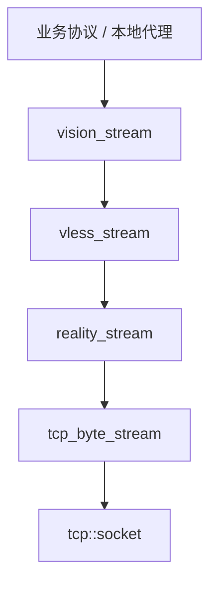
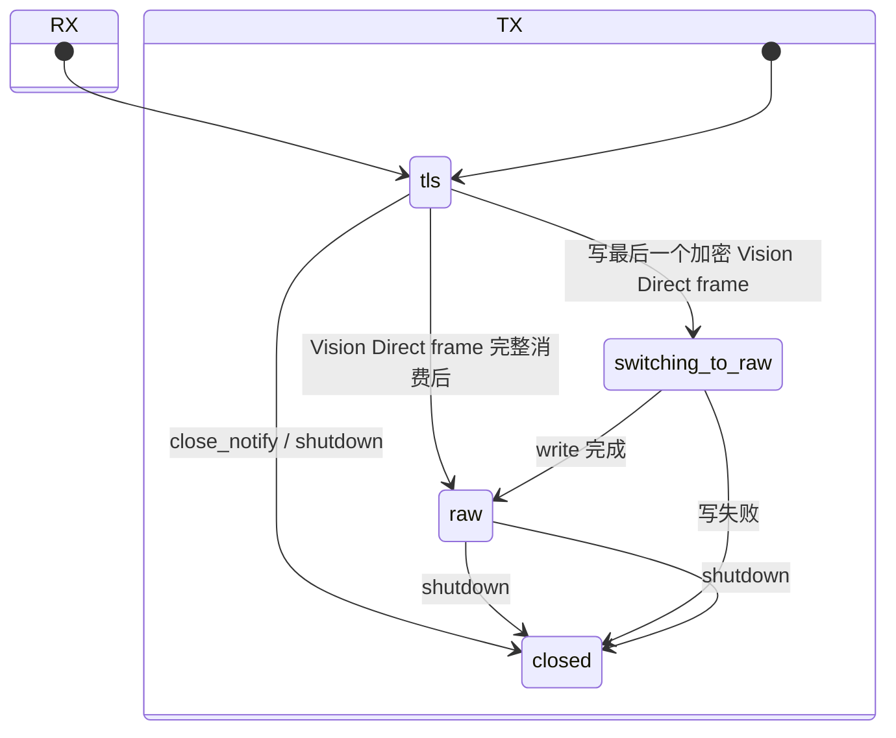

# 架构与协程契约

## 1. 所有权与调用方向

每层 stream 以值语义独占下层：

没有后台 reader，也没有通用 packet dispatcher。上层调用
`read(output)` 时，下层才读取足够的数据来产生结果。这样可以把背压自然地
交给协程调用链。

SOCKS5 服务负责监听、认证协商和解析 TCP CONNECT 目标。认证未配置时选择无认证，
配置凭据时选择 RFC 1929 用户名密码认证。SOCKS 请求直接携带 domain 时保持原有目标；
请求携带 IPv4/IPv6 时，应用层可用 `sniffer` 从客户端首包的 TLS SNI 或 HTTP Host 恢复域名。
SOCKS5 协议模块本身仍不依赖 REALITY、VLESS、Vision 或 sniffer。

Linux IPv4 TCP 透明入站与 SOCKS5 并列。REDIRECT accepted socket 通过 `SO_ORIGINAL_DST` 恢复 NAT 前目标；
TPROXY listener 在 bind 前设置 `IP_TRANSPARENT`，accepted socket 的 local endpoint 保留原目标。透明入口恢复出的
IP:port 与 SOCKS IP request 之后共用同一套 sniffer、VLESS target 构造和 relay；iptables/nftables、fwmark 与 policy
routing 保持在程序外部。

域名目标的连接建立顺序为：

1. `tcp_byte_stream::connect()` 解析地址并建立 TCP；
2. `reality_stream::connect()` 完成 REALITY/TLS 1.3 handshake；
3. `vless_stream::connect()` 发送 VLESS request header；
4. `vision_stream::connect()` 发送带 UUID 的初始 padding frame；
5. 返回 SOCKS success，再进入双向 relay。

IP 目标为了让客户端先产生 ClientHello/HTTP request，会在第 2 步后返回 SOCKS success，
最多缓存客户端首个 16 KiB / 200 ms。探测到域名后再执行第 3、4 步，并把缓存字节原样写入
`vision_stream`；探测失败、超时或达到上限时保持原 IP。透明入口没有 SOCKS handshake，因此 accept 后先恢复
original destination 并建立 REALITY，再执行同样的首包探测和第 3、4 步。TLS sniffer 只解析首个完整
ClientHello handshake record；跨 TLS record 的 ClientHello 直接按探测失败处理，不影响原始数据转发。

## 2. 核心数据结构

| 类型 | 主要状态 | 职责 |
|---|---|---|
| `core::byte_queue` | bounded byte vector + begin offset | 保存跨 TLS record 的 handshake 或明文碎片，限制内存增长 |
| `crypto::aead` | 私有 PImpl | 封装 BoringSSL `EVP_AEAD_CTX`，不向其他模块暴露 BoringSSL 类型 |
| `reality::record_key` | AEAD、12-byte IV、sequence | TLS 1.3 单方向 record protection |
| `reality::reality_stream` | RX/TX mode、receive/send key、两个 byte_queue | TLS application records 与 raw TCP 之间切换 |
| `vless::vless_stream` | response header pending flag | 发送 request header，并在首次读取时消费 response header |
| `vision::server_hello_tracker` | bounded buffer、record length、result | 跨读取片段识别内层 TLS 1.3 ServerHello |
| `vision::vision_stream` | receive phase、frame counters、padding/direct flags | Vision 编解码与两个方向的 Direct 决策 |
| `socks5::connect_request` | address variant + port | 表示 SOCKS5 TCP CONNECT 目标，不包含远端协议状态 |
| `socks5::credentials` | username + password | 可选的本地代理认证配置，不写入日志 |
| `sniff::result` | need_more / no_match / found + domain | 对累计首包做 TLS SNI / HTTP Host 纯解析，不持有 socket |
| `transparent` helper | Linux socket options / original destination | 设置 IPv4 `IP_TRANSPARENT`，读取 REDIRECT `SO_ORIGINAL_DST` |

配置均为不拥有运行时资源的 typed value：

- `reality::client_config`：SNI、REALITY public key、short ID、client version、指纹枚举；
- `vless::client_config`：UUID、目标地址和端口；Vision addon 固定写入请求头；
- 日志上下文使用连接 ID 字符串；spdlog pattern 不输出方括号。

配置解析、Base64/UUID 文本转换和业务路由位于可执行程序边缘；协议类只接收已经验证过
长度的二进制值。它们只是源代码层次上的模块，CMake 会把所有实现直接编入同一个
`reality_vision` 二进制文件。

## 3. REALITY 握手协调

`perform_client_handshake()` 明确实现 TLS 1.3 client handshake，而不是调用 `SSL*`：

1. 构造 Firefox 120 ClientHello，并把 Session ID 区域清零；
2. X25519(client ephemeral, REALITY server static public key)；
3. 使用 ClientHello random 前 20 bytes 为 salt、`REALITY` 为 info 做 HKDF-SHA256；
4. AES-256-GCM 加密 version、timestamp、short ID，并写回 Session ID；
5. 发送 ClientHello，解析 ServerHello 的 cipher、X25519 share 和 Session ID echo；
6. 派生 handshake traffic secrets；
7. 解密并验证 EncryptedExtensions、Certificate、CertificateVerify、Finished；
8. 在包含 server Finished 的 transcript 上派生 application traffic keys；
9. 发送 client Finished，并将 application RX/TX `record_key` 交给 `reality_stream`。

Transcript 保存完整 handshake message（包含 4-byte handshake header），不包含 TLS record
header。ServerHello 之后的 handshake message 可以跨 record，`byte_queue` 负责重组。

## 4. TLS record 与 raw 边界

`reality_stream` 的收、发方向使用两个独立状态机。

RX 每次只读取 5-byte TLS record header，再读取该 header 声明的 payload，绝不预取下一
record。即使一个 TCP segment 同时包含“最后一个外层 TLS record + 第一段 raw 内层 TLS
record”，raw 后缀也仍留在 socket receive buffer 中。Vision 完整消费 Direct frame 后再
调用 `switch_receive_to_raw()`，下一次读取才会拿到该后缀。

TX 先把包含 `command=2` 的完整 Vision frame 作为最后一个外层 TLS application record
写完，之后才把 send mode 改为 raw。这避免 command 自身被提前按 raw 发送。

## 5. VLESS 与 Vision

VLESS request header 使用：

- version `0`；
- 16-byte UUID；
- 固定 addon `xtls-rprx-vision`；
- TCP command；
- big-endian port；
- IPv4/domain/IPv6 address。

VLESS response header 延迟到首次 `read()` 时消费，因此发送方向不需要等待
response header。

Vision 首帧含 16-byte UUID，后续帧使用 5-byte header：

| 字段 | 长度 | 说明 |
|---|---:|---|
| command | 1 | `0` continue、`1` end、`2` direct |
| content length | 2 | big-endian |
| padding length | 2 | big-endian |
| content | variable | 上层数据 |
| padding | variable | 当前填充为零，长度由 BoringSSL CSPRNG 决定 |

发送方向由增量 TLS record tracker 观察内层 ClientHello，并跨写调用保存部分 5-byte record
header 与剩余 payload 长度；接收方向重组并检查内层 ServerHello。确认内层 TLS 1.3 及可
Direct 的 cipher 后，第一个完整的加密 `0x17` record 在其结束边界使用 `command=2`。若该
边界位于一次写入的中间，边界前数据仍作为最后一个 Vision frame 发送，边界后数据立即走
REALITY raw。接收方向只在对端 Direct frame 的 content 与 padding 都完整消费后切换。

## 6. 并发与生命周期约定

每个连接支持：

- 一个活动的读协程；
- 一个活动的写协程；
- 读写可以同时活动。

SOCKS5、REDIRECT 和 TPROXY listener 可以同时运行并服务多个连接；每条连接内部仍遵循一个读协程和一个写协程。一个方向
遇到 EOF 时只 half-close 对端的发送方向，等待另一个方向排空后再关闭整个会话。

stream 不在内部排队或检测同方向并发。调用方必须保证同一时刻最多有一个读操作和一个
写操作；这些对象也不是线程安全容器。当一个 `io_context` 由多个线程运行时，调用方必须
使用同一个 strand 串行化该连接的 handler。

传给 awaitable 写函数的 `std::span` 在 awaitable 完成前必须保持有效。所有需要跨
`co_await` 保存的协议帧都会先复制到本地 `std::vector`。

`shutdown()` 将协议状态标记为 closed 并关闭 TCP。发送方向正常 EOF 时会传播 half-close。

## 7. 错误模型与限制

预期的网络、协议和认证失败统一通过 `boost::system::error_code&` 输出参数传播：

- Asio/TCP 错误保留原始 category 和错误值；
- 本地检测出的格式错误映射为 `boost::system::errc::bad_message`；
- 认证或 Finished/CertificateVerify 校验失败映射为 `permission_denied`；
- 长度上限错误映射为 `message_size`；
- 不支持的版本或算法映射为 `protocol_not_supported` 或 `operation_not_supported`。

异步 I/O 使用 `redirect_error(use_awaitable, ec)`，避免裸 `use_awaitable` 将预期错误转换为
`boost::system::system_error`。只有内存分配失败等非预期 C++ 异常仍可能向上传播，并在
最外层任务边界记录。调用方必须在每次同步解析或 `co_await` 后立即检查 `ec`。

所有可变长度输入都有显式上限：TLS plaintext 16 KiB、TLS ciphertext 上限、handshake
1 MiB、Vision/Xray frame 8192 bytes、内部 byte_queue 上限。身份校验、AEAD tag、Finished
或 CertificateVerify 失败均 fail closed。
